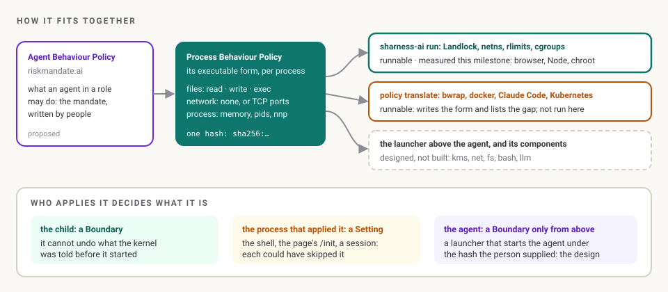

# SHarness: a policy the kernel enforces, for every process an agent starts

> Process Behaviour Policies, shown: the ABP executed underneath the agent, hashed to one name the person supplies and enforced by the Linux kernel. A real kernel boots in the page; the Process Behaviour Policy and its hash; what SHarness can and cannot stop today.

*Source: <https://customers.riskmandate.ai/demos/sharness/> · site v0.2.6 (2026-11-03) · this file is generated from the same content as the page, so the two cannot drift. Every page on this site has a `.md` twin; internal links below point at them.*

---

Demo · Process Behaviour Policies · SHarness, the secure harness

# A policy the kernel enforces, for every process an agent starts.

An Agent Behaviour Policy describes what an agent can do and what stands in the way. A Process Behaviour Policy is that description executed, underneath the agent: what one process may read, write, run and connect to, hashed to one name the person supplies, and enforced by the Linux kernel before the process starts. SHarness is the open-source enforcer.


The one idea. Animation: sharness.ai, CC BY 4.0.

<a id="kernel"></a>

## A real Linux kernel, in this page

Not an animation: Alpine Linux with Landlock on, booted in your browser by an emulator, running the real `sharness-ai` package. It probes the grant (everything allowed), then applies a deny-all policy: writes refused, network refused, memory refused, a wrong hash runs nothing. Six of six. Then the example policies.

Boot it here

About 25 MB, and one to two minutes to boot on an emulated CPU. SHarness, a Landlock kernel in a tab (v86, Alpine), sharness.ai.

Or [open it in its own tab ↗](https://sharness.ai/code/browser/demo/index.html), and [the playground ↗](https://sharness.ai/code/playground/index.html) to try it yourself. If the boot is slow, here is what it shows:


The kernel in a tab, as an animation. sharness.ai, CC BY 4.0.

<a id="policy"></a>

## The Process Behaviour Policy, and its hash

```
{"pbp": 1, "id": "p0-hello-world", "layer": "invocation",
 "files":   {"read":  ["/usr", "/lib", "/lib64", "/bin", "/sbin", "/etc", "/work"],
             "write": [],
             "exec":  ["/usr", "/lib", "/lib64", "/bin", "/sbin", "/etc"]},
 "network": "none",
 "process": {"no_new_privs": true, "max_memory_mb": 64, "max_pids": 8}}
```

Its name: `sha256:a6244d346ea9d7955c04defba5e67f71ae9867af618fa21d11589c7ef8449032`, the same in Python, in the browser and in the Linux guest. Three things make it binding; lose one and it is an expectation again:

1. **The text**: small canonical JSON.
2. **The hash, from outside**: supplied by the person. A prompt-injected agent cannot widen what it cannot rename.
3. **An enforcer it does not include**: the kernel, told before the process starts.


`sharness-ai hello`, six of six. sharness.ai, CC BY 4.0.

<a id="try"></a>

## Try it on Linux

```
pip install sharness-ai        # v0.2.0, 29 October 2026
sharness-ai probe              # the grant: what a process can do before any policy
sharness-ai hello              # six probes under deny-all
sharness-ai run --policy p2-tool-server.json --expect-hash sha256:... -- my-tool
sharness-ai contain --workspace . --sites github.com -- my-agent
```

Linux 5.13 or later (TCP port rules need 6.7). Python 3.11 or later, standard library only. macOS refuses and runs nothing; Windows is not supported yet.

<a id="fits"></a>

## How it fits with an Agent Behaviour Policy


From a mandate to a kernel. sharness.ai, CC BY 4.0.

RiskMandate writes down the gap and which rows are only hope; SHarness is how a row becomes a boundary. A rule in the prompt is an expectation; a hook in the agent's harness is a setting; a policy the kernel holds, supplied from outside, is a boundary for the process it starts.

<a id="honest"></a>

## What it can and cannot stop today

| A tampered Claude Code extension did, on 29 October | What a written policy refuses | Today |
|---|---|---|
| Added an SSH key | a write outside the workspace | runs today |
| Planted persistence | a write outside the workspace; a writable path is never executable | runs today |
| Opened a reverse tunnel | no network, or only the hosts you named | runs today |
| Read the names of secrets | keys held by a door, never handed over | designed |
| Ran inside the editor on load | a boundary around the editor | designed |

So, would it have stopped that build? **No, not today**: Linux only, and nothing yet confines an editor. Every step it took is one a written policy refuses, which is the argument for having one. [The full account ↗](https://newsroom.sgit.ai/articles/lovable-with-sharness.html) · [SHarness's honest column ↗](https://sharness.ai/evidence/status/index.html)


Where it is going: the operating system of one process. sharness.ai, CC BY 4.0.

SHarness is by Dinis Cruz: code Apache-2.0, site CC BY 4.0, experiments and MVPs, pre-alpha. The animations here are copied from sharness.ai byte for byte; their sources are in `assets/present/sharness/SOURCES.md`.

---

*[Site index for agents](/llms.txt) · [What exists](/docs/reality.md) · [HTML version](https://customers.riskmandate.ai/demos/sharness/)*
